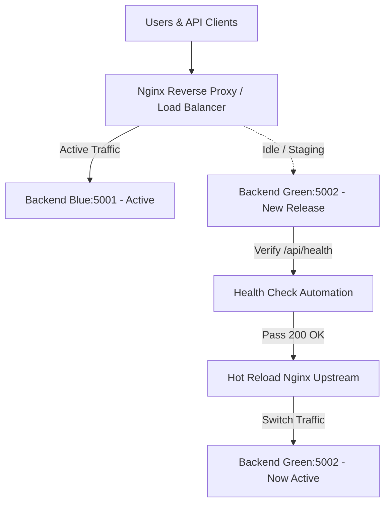

# Blue-Green Deployment Strategy for Roots Tunisia

## Overview
Roots Tunisia uses a zero-downtime **Blue-Green Deployment** strategy to ensure that new application code, security patches, and database optimizations are released to users without service disruption.



---

## Architectural Components

1. **Nginx Reverse Proxy (`nginx/blue-green.conf`)**:
   - Manages client TLS/HTTP termination on port 80/443.
   - Forwards `/api/*` traffic to an internal upstream definition `backend_upstream`.
   - Supports live reload (`nginx -s reload`) without terminating ongoing client connections.

2. **Two Identical Application Environments**:
   - **Blue Instance (`rootstunisia_backend_blue`)**: Exposes port 5001 internally.
   - **Green Instance (`rootstunisia_backend_green`)**: Exposes port 5002 internally.
   - Both share the persistent uploads volume (`backend_uploads`) and connect to the MySQL database.

3. **Automated Health Checking**:
   - The deployment script interrogates `GET /api/health` on the staging container up to 20 times (with 3-second intervals).
   - Only when HTTP 200 is confirmed (verifying database connectivity, Knex query execution, and memory safety) does traffic cutover take place.

4. **Zero-Downtime Rollback**:
   - If the staging healthcheck fails, the new container is safely stopped, leaving the active container untouched.
   - If an unexpected error is detected post-cutover, executing the script again immediately reverts traffic to the previous environment within 1 second.

---

## How to Execute a Deployment

### On Linux / Docker Host:
```bash
chmod +x scripts/blue-green-deploy.sh
./scripts/blue-green-deploy.sh
```

### On Windows PowerShell:
```powershell
.\scripts\blue-green-deploy.ps1
```

---

## Database Schema Compatibility Guidelines

In a Blue-Green deployment where two versions of the app may run concurrently for brief windows:
1. **Additive Schema Changes**: Always add columns with `NULL` or default values before removing old columns.
2. **Backward-Compatible Queries**: Ensure existing code can run with the new database schema before deploying code changes.
3. **Patcher Resilience**: Roots Tunisia's `ensureCriticalSchema` and `ensurePerformanceIndexes` run idempotently on startup.
